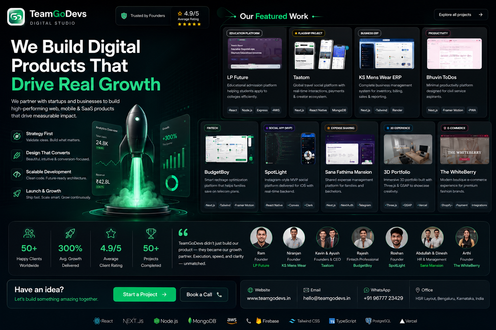

<p align="center">
  
</p>

<h1 align="center">TeamGoDevs</h1>

<p align="center">
  <strong>Web, Mobile &amp; SaaS Product Development Studio</strong>
</p>

<p align="center">
  We design, build, launch, and support digital products for startups and growing businesses —
  from MVPs to production platforms.
</p>

<p align="center">
  <a href="https://www.teamgodevs.in/">Website</a> ·
  <a href="mailto:hello@teamgodevs.in">hello@teamgodevs.in</a> ·
  <a href="https://wa.me/919677723429">+91 96777 23429</a>
</p>

---

## About us

**TeamGoDevs** is a digital product studio based in **HSR Layout, Bengaluru**.

We partner with founders and teams to ship high-performing:

- Web applications (React / Next.js)
- Mobile apps for iOS & Android (React Native)
- SaaS platforms, CRMs, and business software
- Ecommerce experiences
- UI/UX design & brand identity
- SEO, growth, and cloud / DevOps support

Our focus is simple: **build products that ship**, stay maintainable, and support real business outcomes — not just demos.

---

## What this repo is

This repository powers the official TeamGoDevs portfolio site:

**[https://www.teamgodevs.in/](https://www.teamgodevs.in/)**

It showcases our studio, services, process, selected client work, and contact flow.

### Selected work highlights

| Project | Focus |
|--------|--------|
| **Taatom** | Travel social platform (web + mobile) |
| **KS Mens Wear ERP** | Business management / inventory & billing |
| **Lakshya CRM** | Lead & operations CRM |
| **Lakshya** | Finance-focused web platform |
| **Xelarvis** | AI research & consulting web presence |
| **BudgetBoy** | Telecom plan optimization |
| **The WhiteBerry** | Boutique ecommerce |
| **SpotLight** | Social app MVP |
| **LP Future** | Education admissions platform |

Explore the full Work section on the live site.

---

## Repository structure

```
.
├── api/                     Express + MongoDB backend (TypeScript)
│   └── src/
│       ├── config/          env, MongoDB connection, Razorpay client
│       ├── constants/       server-side price catalog
│       ├── controllers/     HTTP handlers
│       ├── middleware/      error handling, rate limiting
│       ├── models/          Mongoose models (ContactInquiry, Order)
│       ├── routes/          /api router
│       ├── services/        business logic (contact, payments, email)
│       ├── templates/       transactional email HTML
│       ├── utils/           request metadata, pricing, helpers
│       └── validators/      Zod request schemas
└── web/                     Vite + React frontend (deployed on Vercel)
```

## Tech stack

- **web** — Vite, React, TypeScript, Tailwind CSS, shadcn/ui, Framer Motion
- **api** — Express 5, Mongoose (MongoDB Atlas), Razorpay, Resend, Zod

### API endpoints

| Method | Path | Purpose |
|--------|------|---------|
| GET | `/api/health` | Service status (database, payments, email) |
| GET | `/api/geo` | Visitor country → pricing region |
| POST | `/api/contact` | Contact form (saved to MongoDB + emails) |
| POST | `/api/create-order` | Create a Razorpay order |
| POST | `/api/verify-payment` | Verify checkout signature, mark order paid |
| POST | `/api/payment-failed` | Record a failed payment attempt |
| GET | `/api/orders/:orderId` | Public order status |
| POST | `/api/webhooks/razorpay` | Razorpay webhook (`payment.captured`, `order.paid`, `payment.failed`) |

---

## Local development

```bash
# Install both apps
npm run install:all

# Configure secrets
cp api/.env.example api/.env   # MongoDB, Razorpay, Resend
cp web/.env.example web/.env   # public build-time vars

# Terminal 1 — API on http://localhost:5050
npm run dev:api

# Terminal 2 — web on http://localhost:8080 (proxies /api to the API)
npm run dev:web
```

Other web scripts (`npm --prefix web run …`): `build`, `preview`, `lint`, `seo:audit`.

### Payments

- `/payment?project=<student-project-id>` — fixed-price student project (priced on the server).
- `/payment?amount=5000&for=Invoice%20INV-1042` — shareable custom-amount payment link.

### Deployment

- **web** → Vercel with Root Directory `web`. Set `VITE_API_URL` to the API origin.
- **api** → any Node 20+ host (Render, Railway, Fly, VPS): `npm run build && npm start`.
  Add the web origin to `CORS_ORIGINS`, and register `https://<api-host>/api/webhooks/razorpay`
  in Razorpay Dashboard → Webhooks with the same secret as `RAZORPAY_WEBHOOK_SECRET`.

---

## Contact

| Channel | Details |
|--------|---------|
| Website | [www.teamgodevs.in](https://www.teamgodevs.in/) |
| Email | [hello@teamgodevs.in](mailto:hello@teamgodevs.in) |
| WhatsApp | [+91 96777 23429](https://wa.me/919677723429) |
| Office | HSR Layout, Bengaluru, Karnataka, India |
| Hours | Mon – Fri, 10:00 AM – 7:00 PM IST |

Have an idea? Let’s build something useful together.

---

<p align="center">
  <sub>© TeamGoDevs · Digital product studio since 2019</sub>
</p>
